# Act I Pilot — Visual Targets and Revision Archive

Selected explorations from the 2026-10-18 art discussion. These PNGs are visual targets, not historical evidence or final modeling sheets. Originals, native dimensions, SHA-256, reference-image lineage and scoped approval are in [manifest.json](manifest.json). All are native 1536 × 1024; no 6K delivery is claimed.

11 selected images cover five base subjects and six state studies. Six replaced/rejected images remain in Archive for provenance; never use them as current targets. All source IDs refer to the [evidence dossier](../../Act_I_Evidence_Dossier.md). See [review and production limits](../../../Docs/Art/Concept_Pilot_Review.md).

## Selected targets

### B01-HOUSE-A/summer/r03

Round logs; moss chinking; tar-dark corners; continuous irregular partly buried fieldstones, some boulder-sized; minimal boards.

Sources/inspiration: R01, R02, R11. See dossier for limits; artwork is not evidence.

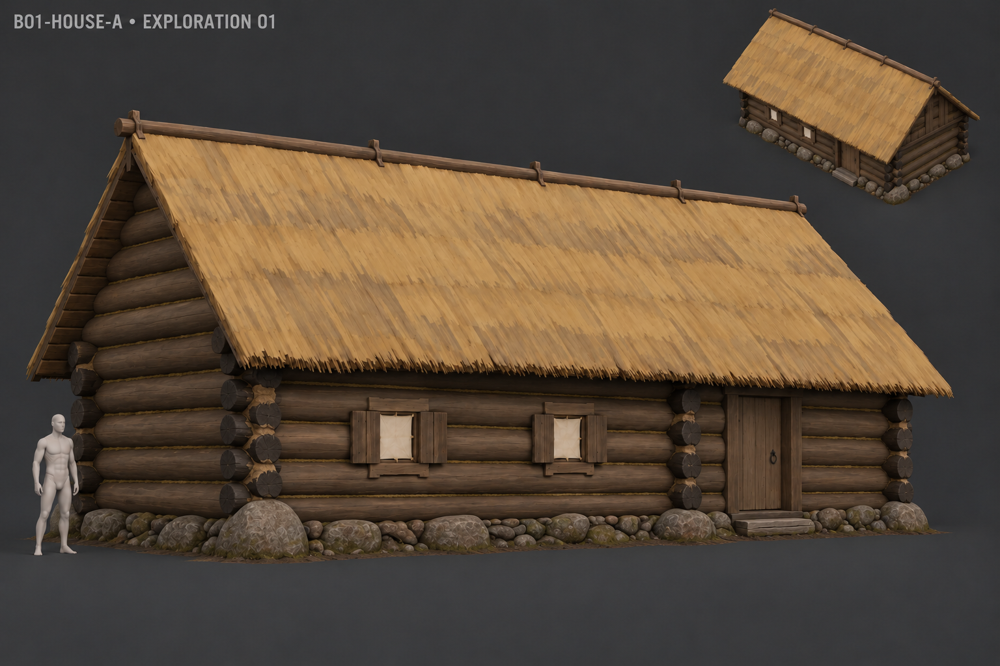

### C01-ALDER-A/summer/r02

Few broad canopy masses and simple faceted trunk.

Sources/inspiration: R19, R20. See dossier for limits; artwork is not evidence.

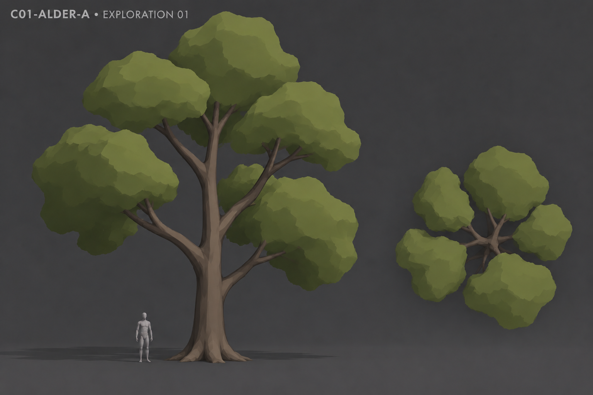

### D01-GROUND-WATER-A/summer/r02

Gentle bank; broad ground masks; two sedge tufts; natural brown shallow water.

Sources/inspiration: R19, R20, R22. See dossier for limits; artwork is not evidence.

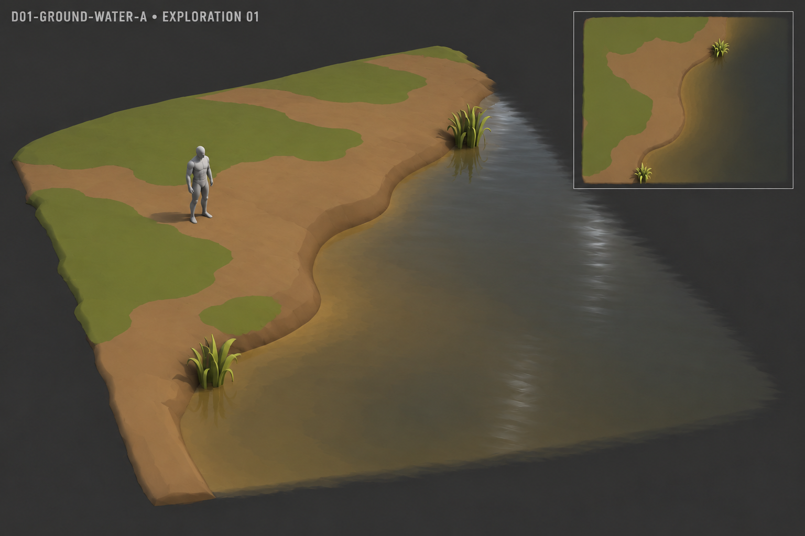

### F03-PAIR-M/summer/r02

Ordinary human proportions; simplified face/hair; linen shirt, belt, trousers, wraps and plain shoes.

Sources/inspiration: R01, R03, R04. See dossier for limits; artwork is not evidence.

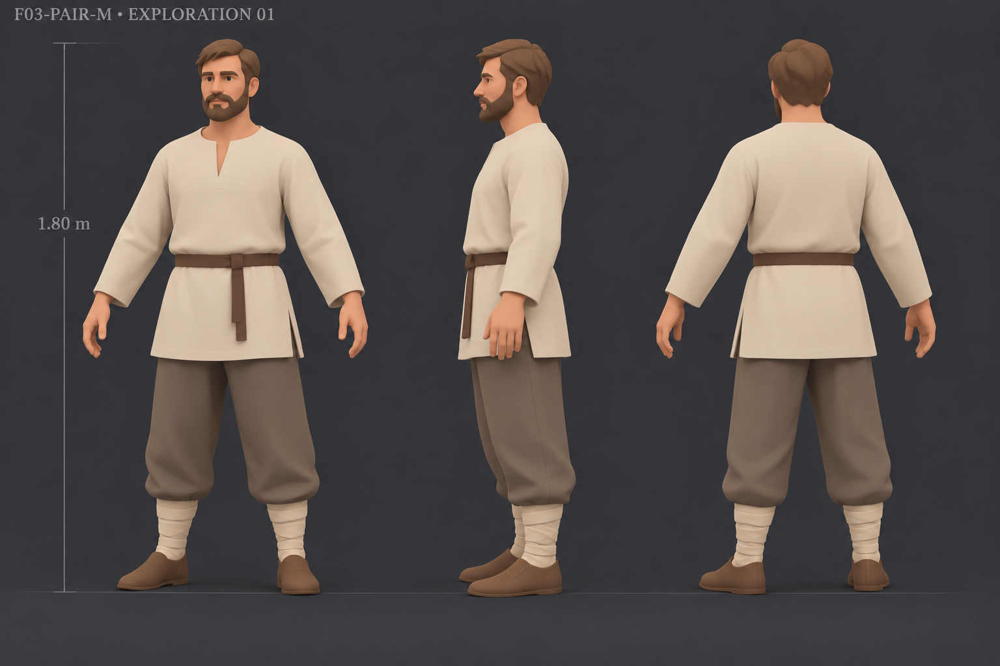

### I02-BOLOTNIK-A/base/r02

Greener olive hair/beard and broader moss coverage; barefoot humanoid in plain clothes.

Sources/inspiration: R08. See dossier for limits; artwork is not evidence.

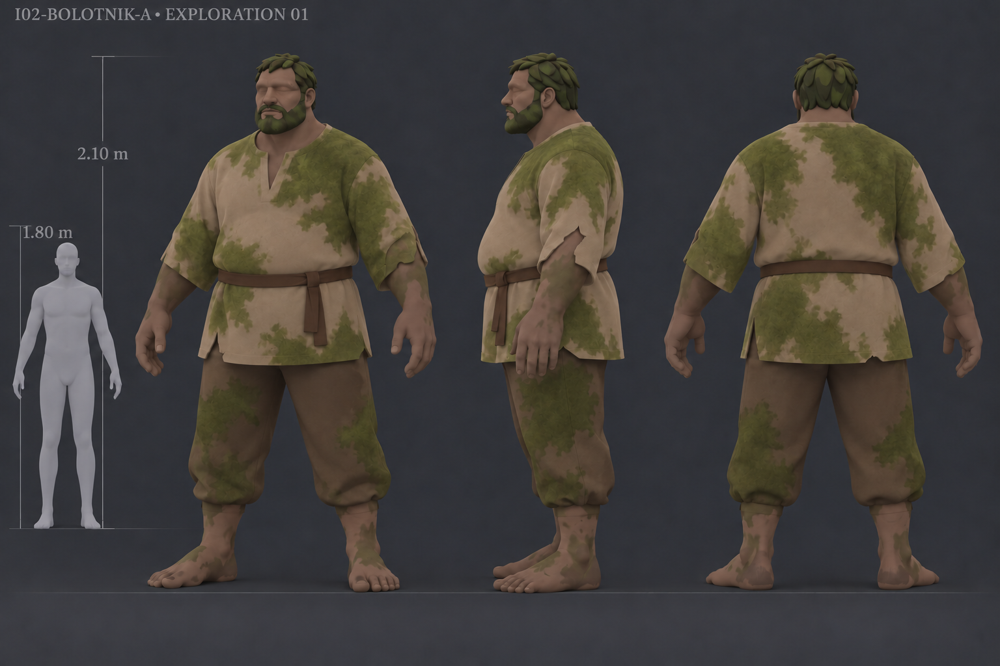

### F03-PAIR-M/winter/r01

Same male identity; inward-fleece sheepskin coat, warm cap, mittens and boots; cut provisional.

Sources/inspiration: R01, R03, R04. See dossier for limits; artwork is not evidence.

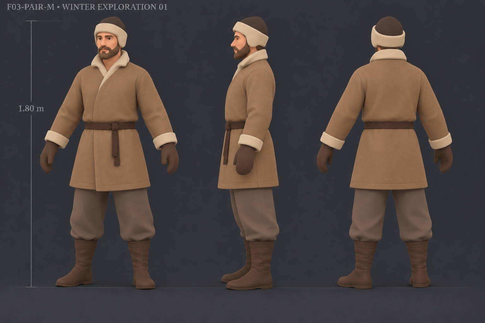

### B01-HOUSE-A/winter/r01

Same house; closed shutters; roof/stone snow; trodden door approach.

Sources/inspiration: R01, R02, R11. See dossier for limits; artwork is not evidence.

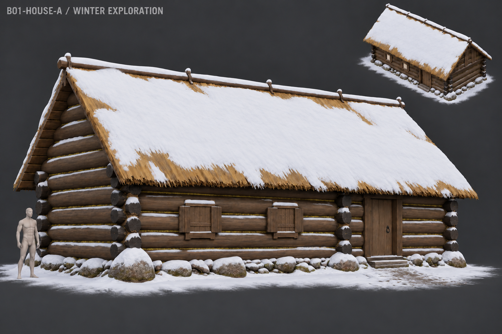

### C01-ALDER-A/winter/r01

Leafless trunk/branch continuity and restrained snow; simplify excess twigs before modeling.

Sources/inspiration: R19, R20. See dossier for limits; artwork is not evidence.

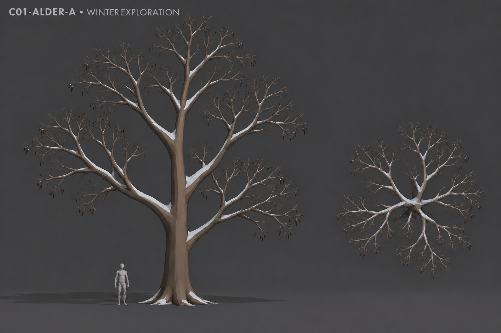

### D01-GROUND-WATER-A/winter/r01

Snow, dry sedge, thin shore ice and open peat-brown water; partial freezing example.

Sources/inspiration: R19, R20, R22. See dossier for limits; artwork is not evidence.

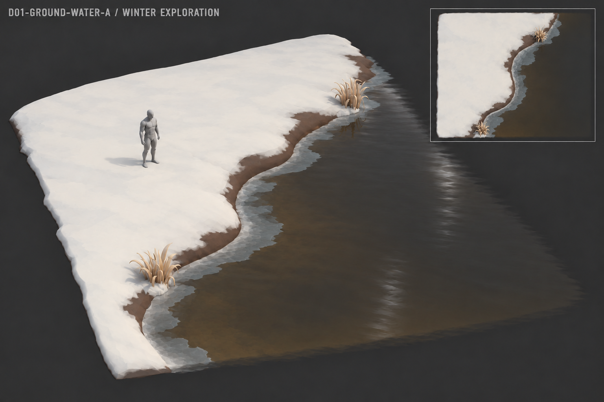

### D01-GROUND-WATER-A/curse/r01

Localized plum/violet ground-to-water stains; sparse lilac activity; retain ordinary colors.

Sources/inspiration: GAME, INSP-01. See dossier for limits; artwork is not evidence.

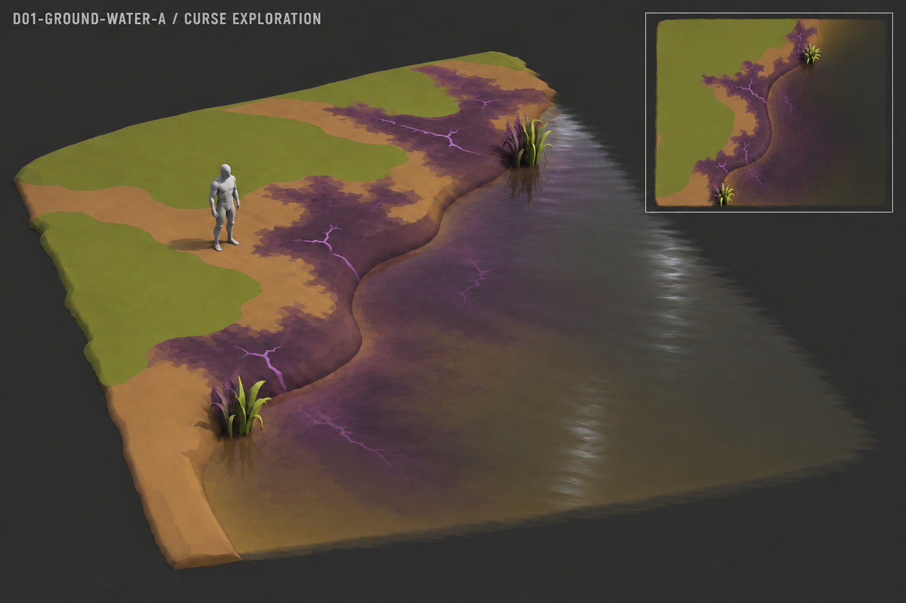

### D01-GROUND-WATER-A/winter-curse/r01

Same Curse cue on snow/ice/water; dark value carries winter readability.

Sources/inspiration: GAME, INSP-01. See dossier for limits; artwork is not evidence.

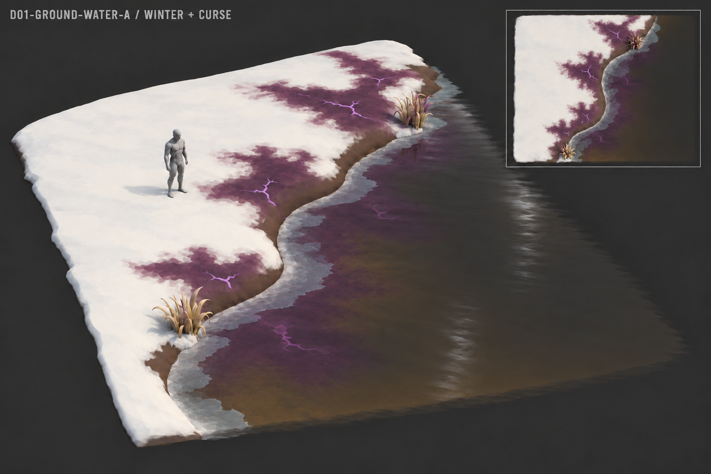

## Revision archive

| Revision | Disposition | Reason |
|---|---|---|
| [B01-HOUSE-A/summer/r01](Archive/B01-HOUSE-A_summer_r01.png) | Rejected | Floating appearance / isolated decorative supports |
| [B01-HOUSE-A/summer/r02](Archive/B01-HOUSE-A_summer_r02.png) | Superseded | Foundation improved; round logs, moss, tarred corners and irregular boulders requested next |
| [C01-ALDER-A/summer/r01](Archive/C01-ALDER-A_summer_r01.png) | Superseded | Too detailed; user requested simplification |
| [D01-GROUND-WATER-A/summer/r01](Archive/D01-GROUND-WATER-A_summer_r01.png) | Superseded | Replaced by simpler broad terrain/material masses |
| [F03-PAIR-M/summer/r01](Archive/F03-PAIR-M_summer_r01.png) | Superseded | User preferred second, simplified character variant |
| [I02-BOLOTNIK-A/base/r01](Archive/I02-BOLOTNIK-A_base_r01.png) | Superseded | User requested greener hair and more moss on clothing |
